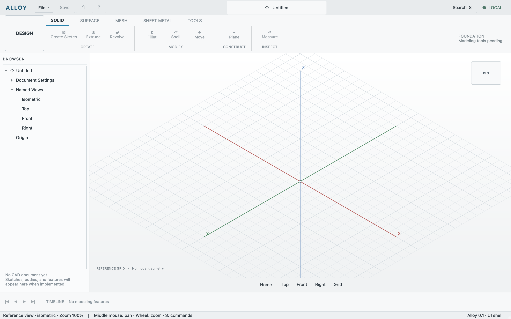

# Current-shell validation baseline

Observed 2026-10-11 on Apple silicon macOS. This validates the existing native
shell and its real control path. No CAD object can yet be created: the document,
kernel integration, modeling, persistence, and interchange layers are pending.

## Actions and results

1. `cmake --build build` passed.
2. `ctest --test-dir build --output-on-failure` passed, 1/1. The test launched the
   actual application, inspected its command registry, changed view/layout state,
   checked errors, opened/closed search, captured distinct PNGs, and exited.
3. Computer use operated **Alloy**, covering physical-input behavior beyond the
   API smoke: `S` opened native command search, confirmed by API state.
4. The API selected Top. Typing `Home` in the actual search field and pressing
   Return executed Home and dismissed search; API state confirmed isometric view
   and search visibility false.
5. Physical `Cmd+Option+B` hid Browser. The native accessibility tree and API state
   both confirmed the result. `layout.reset` restored the layout through the API.
6. The running user shell was captured and left open for inspection.

The public-safe [result record](2026-10-11-shell.json) includes capture checksum
and scope. Full local API transcripts and intermediate states are in ignored
`build/evidence/`; [development.md](../development.md) explains how to reproduce
the automated check. The physical-input observations are session evidence, not
a newly automated physical-input suite.

## Limits

The view is an independently painted reference grid. OCCT discovery is not
geometry integration. There is no modeled object, selection/picking, arbitrary
orbit, editable history, save/open, import, or print export. No exact visual match
has been accepted. Remaining physical inputs and focus behavior need targeted
checks as the relevant features are implemented.

Future validation gates must create actual useful geometry and re-run the earlier
workflow fixtures cumulatively. This baseline cannot satisfy those later gates.
