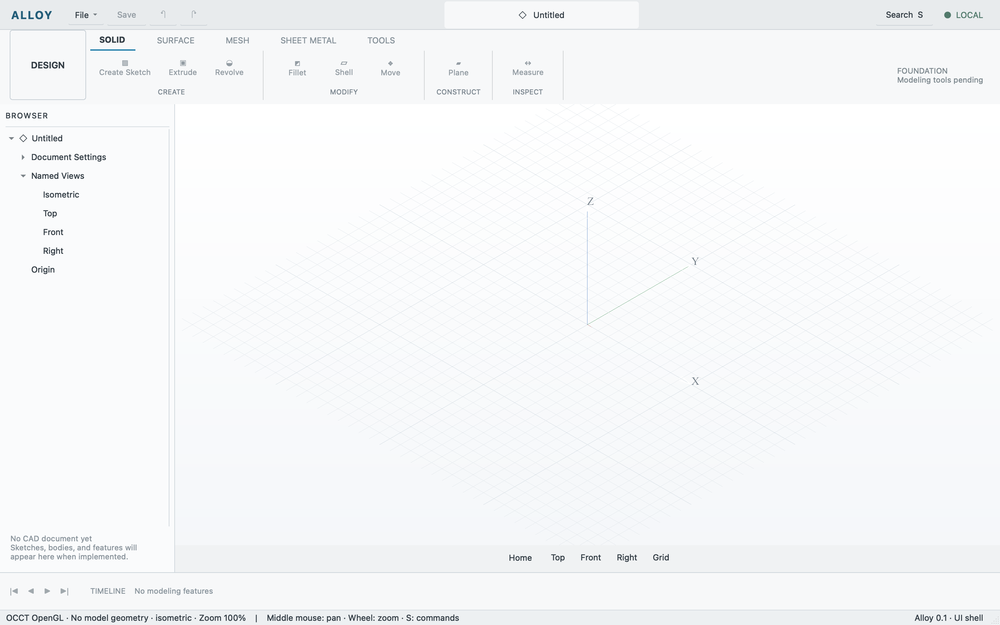

# Accelerated viewport foundation

Observed 2026-10-11 on Apple silicon macOS. The Qt shell now embeds OCCT 7.9.3
AIS/V3d/OpenGL. Its grid and axes are real GPU presentations, with no authored
CAD document or bodies.

The Debug build and real-app CTest passed 1/1. Live driver diagnostics report
**Apple / Apple M4 / OpenGL 4.1 Metal - 90.5 / GLSL 4.10**. The test checks native
GL viewport dimensions at startup before any screenshot and after resize before
the resized capture. On the verified Retina display, DPR is 2: a 1440×900 window
captures at 2880×1800 and a 1200×800 window at 2400×1600. Isometric and Top yield
different framebuffer hashes, independently of shell text changes.

Computer use observed the actual Alloy window and its rendered grid/axes, then
clicked Top and checked shared state. Physical `S`, `Home`, and Return opened
search and restored Isometric. The final app was relaunched and left open. This
was Alloy-only verification; reference CAD application was never run or inspected.

The [result record](2026-10-11-gpu.json) retains source/binary/capture hashes,
renderer details, sizes, smoke evidence, and limitations. The API PNG combines
Qt chrome with an OCCT offscreen GPU rendering of the same scene/camera; it is
separate from the session's native-compositor observation. Reproduce with the
commands in [development](../development.md).

This is partial progress on [DOC-005 #17](https://github.com/rje/Alloy/issues/17).
That issue and GATE-010 stay open: document geometry, picking, persistent state,
and useful CAD workflows remain absent. Hardware identity is not a performance
benchmark. Cross-display scale changes and Windows/Linux runtime behavior remain
unverified. The [original shell receipt](current-shell.md) preserves GATE-000's
earlier QPainter baseline.
