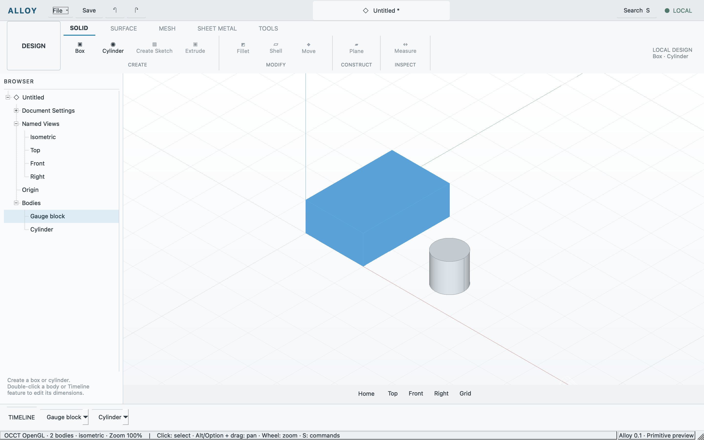
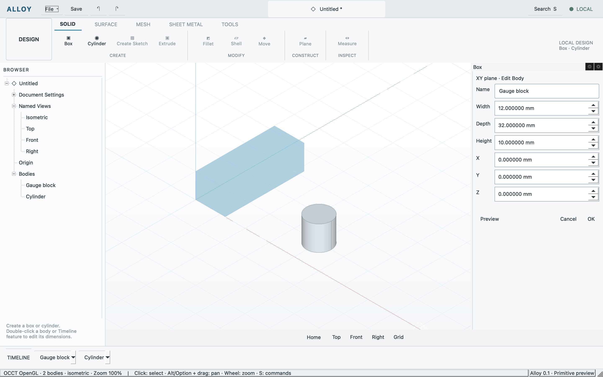

# Mac input, docked editing and visible selection

Verified 2026-10-11 on Apple silicon macOS with Qt 6.11.2 and OCCT 7.9.3.
[Machine-readable receipt](mac-editing.json) records the candidate and evidence.

Fractional logical mouse coordinates previously became zero through JSON integer
conversion. Picking now preserves doubles until native-window rounding. The
actual Retina odd-pixel click selects the evaluated body. Selected bodies use a
distinct blue shaded highlight; clearing selection restores normal appearance
without editing the document.

Option/Alt plus left-drag adds pan for users without a middle button. Existing
middle drag/wheel zoom remain supported. The modeless primitive editor is an
actual Qt QDockWidget, initially beside the canvas on its right, with float/redock
and Close controls. Field completion invokes shared update/preview. Editing
preview hides the target presentation so a smaller draft remains visible;
cancel, failure and stale-session handling restore the original.

The final cumulative primitive regression passed shell, authored document,
command sessions and primitive workflows once each, then reused those results
for the aggregate. Added assertions cover fractional picking, dock/float state,
canvas nonoverlap, preview restoration, visible selection, exact cleared image
restoration and unchanged authored state. Astra reviewed the source and matching
binary/artifact evidence with no material blocker.

Separate native checks on the docked candidate covered an odd-pixel click,
actual spinbox text typing then direct OK without Tab, undo, and dock-title Close
cancellation. An accessibility click on the stepper did not focus its text;
clicking the actual text field did. These checks predate the later selection-color
change, which was separately regression-tested and visibly observed on the native
window. The user model was preserved and reopened with three bodies.

The exposed computer-use tool cannot hold Option during a drag, so physical
modifier-drag remains unverified; its shared pan path and source were checked.
Only macOS runtime is qualified. No exact visual/workflow parity is claimed;
[public reference findings](../research/primitive-editing.md) retain the gaps.

