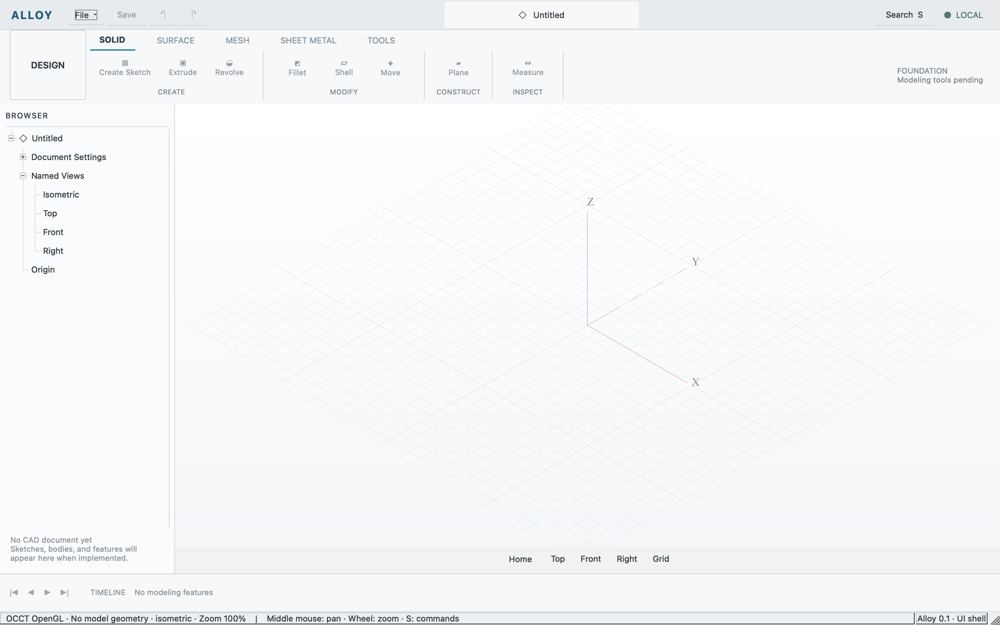

# Current shell after publication cleanup

Observed 2026-10-11 on macOS Apple silicon. The source uses Qt's public Windows
widget style, with Alloy's palette and independently authored UI. Native Debug
build and CTest `shell_api` passed 1/1 through the real application entrypoint.
Commands, search, structured errors, layout changes, startup/resize drawable
sizes, camera changes, captures and clean exit were exercised.

Live OCCT diagnostics still identify Apple / Apple M4 / OpenGL 4.1 Metal - 90.5.
This proves hardware viewport operation on this host, not cross-platform runtime
qualification or CAD modeling. The scene remains grid and axes without an
authored document. The [result record](neutral-shell.json) contains source and
binary hashes plus the complete real-app smoke result.

The capture combines Qt chrome with an OCCT offscreen rendering of the same
scene and camera. It was visually inspected for missing regions and clipping.
Physical keyboard/mouse and native-compositor observations from the earlier GPU
receipt remain historical; they were not repeated for this style change. No
exact visual compatibility claim is made.
