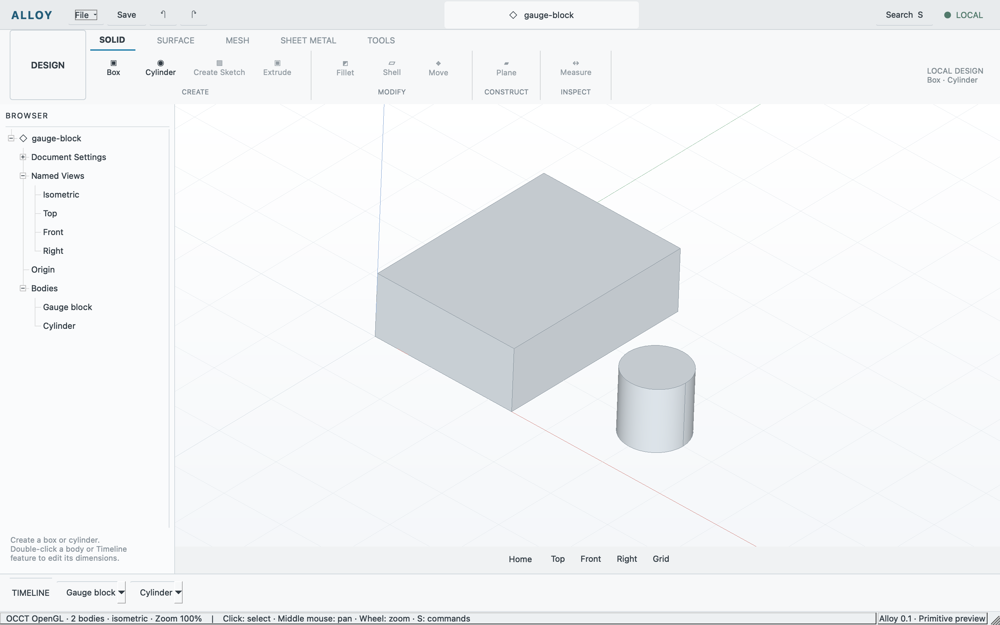

# First editable primitive workflow

Recorded 2026-10-11 local time, macOS 26.5.1 arm64, Qt 6.11.2, OCCT 7.9.3.
The [machine receipt](primitives.json) identifies the tested executable, source/
fixture inputs, retained report and public capture. The report tested a dirty
working candidate based on 782425b; its per-file digests identify the implementation
reviewed and subsequently published. Documentation updates do not rerun the app.

The application now creates real boxes and cylinders, renders/picks their OCCT
BReps, edits dimensions with disposable previews and commits each edit through
one QUndoStack. Authored JSON, evaluated-body snapshots and presentation remain
separate. Save uses QSaveFile; reopen validates and evaluates before replacing
live state. Editable features survive reopen; the session journal starts clean.

## Executed checks

`python3 tests/workflows/run.py --case primitive-regression --evidence build/evidence/primitive-regression`
passed shell, DOC-002, FND-006 and primitives on the same executable. The aggregate
case reuses those fresh runs rather than launching duplicate app workflows.
DOC-003/004/005/007/008 aliases refer to the shared primitive evidence.

The primitive workflow checked box preview/cancel/commit, a separate cylinder,
actual validity/topology/bounds/analytic volumes, body projection and OCCT picking,
camera framebuffer changes, edit/undo/redo, delete/undo and branching after undo.
It checked mm/in conversion, real edit-dialog values, invalid edit preservation,
atomic native save, failed-write preservation, malformed/future-schema refusal,
clean reopen, editable IDs/parameters after reopen and saved-checkpoint tracking.
Failed preview validation clears both the disposable shape and preview status.

Focused geometry-kernel, authored-document and client-selection CTest checks
passed 3/3. The real app regression separately passed the shared quit path,
including explicit dirty discard without a second native confirmation.

Astra independently reviewed source, transaction/storage boundaries, preview
failure/staleness, candidate consistency and retained evidence. Two material
findings—stale preview geometry and a repeated quit confirmation—were fixed
before the final fresh regression. Astra approved this bounded slice, without
claiming broader product or physical/visual acceptance.

## Separate physical observations

Computer-use tools operated Alloy's own native window: toolbar Box, typing a
35 mm width, commit, Cmd+Z, Cmd+Shift+Z, native Save to a test `.alloy` file,
Timeline edit showing the stored width, and Cancel. API inspection confirmed one
valid 35 × 30 × 10 mm solid, volume 10500 mm³, one journal entry and a clean saved
checkpoint. Native compositor images showed the actual solid in the window.
The API then opened `examples/gauge-block.alloy`, fit Home and captured the image
above. The app was left open with the two-body sample for a human test.

An accessibility-element click on a Browser body row did not select it. This
does not qualify physical Browser selection; viewport picking was verified
through the real OCCT control path. Broader selection remains DOC-006.

## Acceptance boundaries

This evidence supports DOC-003 transactions, DOC-004 native storage, DOC-005
document BRep rendering/picking, DOC-007 editable primitives and DOC-008 summaries.
It does not close GATE-010: STEP read/write and independent readback are pending.
Printing export, sketches, dependent modeling, face/edge selection, persistent
face/edge references, broader Browser controls, observable pending document
decisions and full native dialog coverage remain separate issues.

World-XY placement, New Body and initial dimension defaults are bounded Alloy
proposals; no exact-reference interaction or screenshot compatibility is claimed.
The public image combines actual Qt chrome and the GPU-rendered OCCT scene;
it is an API capture, distinct from the separately observed native compositor.
Hardware evidence identifies Apple M4; other-OS runtime/package qualification
and model performance are not inferred from it. No binary release is published.
