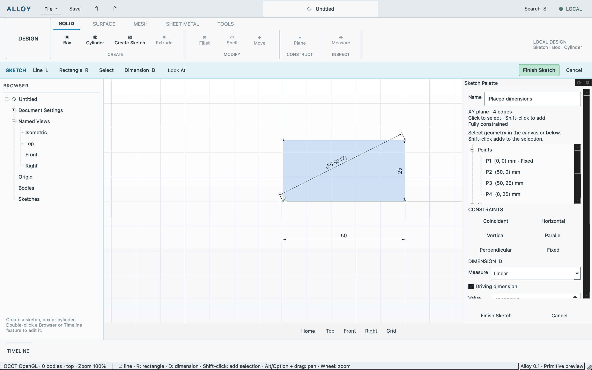

# Placed sketch dimensions and valid line profiles

Verified 2026-10-11 on Apple silicon macOS; Qt 6.11.2, OCCT 7.9.3 and the
integrated PlaneGCS adapter. [The receipt](sketch-annotations.json) identifies
the exact candidate, executed checks, artifacts and limits.

The real app now previews and places complete linear dimension graphics, opens
an adjacent numeric editor, accepts mm/in input, edits driving labels and moves
their authored anchors. Annotation movement preserves point records exactly.
Finish uses the existing one-transaction document authority; undo and native
save/reopen retain dimension IDs and placements. Driven labels remain read-only
measurements with parentheses.

One solved connected closed line loop produces a valid planar OCCT face with
stable profile identity and edge provenance. Its actual face is triangulated for
GPU fill; API/native interior picking resolves that same profile. Open or
self-crossed boundaries produce useful diagnostics without invalidating the sketch.
The focused rectangle fixture measured 1000 mm2, then 1250 mm2 after width 40→50,
with retained identity across edit and reopen.



The focused core document/profile tests passed. The new real-entrypoint case
passed on final binary `1610e1ed19378ff5c0ec2d1d4b133559df2d089028598e5c94caa175c9d4bb56`:

```sh
python3 tests/workflows/run.py --case sketch-annotations --evidence build/evidence/annotations-final
```

Native input verified profile selection, edge click→D→placement→50 mm→Enter,
then label double-click/edit→55→Enter, dragging and Escape cancellation. The
first double-click attempt selected the label; the reattempt opened its editor.
The drag evidence has identical authored points/values and a changed placement.
An API-opened editor followed by native typing/Escape retained the usable draft.
One API zoom confirmed attached label/hit bounds. Native Finish produced one
undo entry and a 55 × 25 profile of area 1375 mm2. The native fixture was saved
before the app was left editing the documented 50 × 25 sample.

Astra independently reviewed source, final API/native captures and matching
source/executable/artifact hashes. Three earlier visual failures—text rotation,
invisible profile fill and pale strokes—were corrected. A subsequent beside-line
layout removed numbers intersecting the dimension line. Those earlier captures
are failed presentation evidence, not accepted examples. No unrelated app cases
were repeated for the final UI corrections.

This accepts SKT-014's single-loop profile scope and the implemented portion of
SKT-005. Full SKT-005 remains open for broader physical inputs/inference. Glyphs,
per-entity freedom diagnostics, visibility controls, wider dimension families and
general collision handling remain tracked gaps. Fill/picking currently works
during sketch editing; extrusion and post-Finish profile selection are next.
Public-reference scale/theme/release is unmatched, so the screenshot establishes
the stated Alloy presentation rather than exact visual parity. Windows/Linux
runtime, native Metal/Vulkan, tutorial gates and cumulative release gates remain
unverified by this slice.
