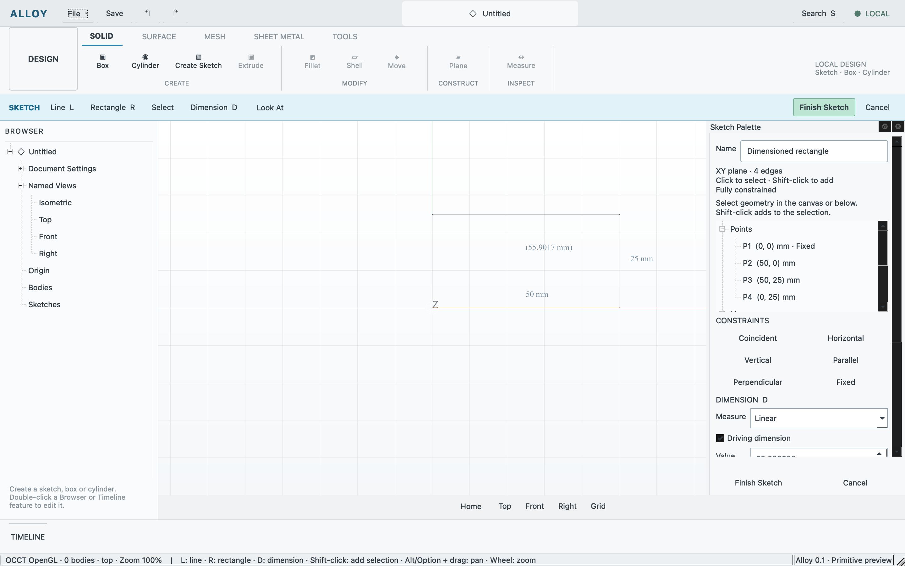

# Sketch constraints and dimensions

Recorded 2026-10-11 on macOS arm64. SKT-003/004 now use the actual shared PlaneGCS
solver in the Qt/OCCT application. Supported relations are coincident,
horizontal, vertical, parallel, perpendicular and fixed. Straight-line sketches
support linear/horizontal/vertical driving dimensions and driven measurements.
New rectangles receive four H/V constraints automatically; earlier saved sketches
retain their authored intent.

The [candidate receipt](sketch-constraints.json) separates native core checks,
application commands, physical inputs and captures. A 40×25 rectangle was anchored,
dimensioned, widened to 50 and independently inspected. Its driven diagonal updated,
zero DOF and residual checks passed, and conflicts preserved the usable draft.
An explicit stale line ID rejects rather than using unrelated selected geometry.
Finish creates one undo entry; cancel, undo/redo, authored save/reopen and subsequent
dimension editing passed through the real application entrypoint.

The first integrated candidate passed the existing shell/document/session/primitive
and sketch workflows plus the new constraint case. After two bounded UI fixes,
only the affected constraint case was repeated: explicit line identity and readable
palette colors. The receipt identifies each binary separately; it does not claim
the old aggregate ran on the final binary. Adapter/document CTest fixtures passed. Astra independently reviewed the UI/core
and final evidence; root and the document agent reviewed the solver/build code
authored by Astra. No material blocker remains for this bounded subset.

A separate native check clicked a line, observed orange selection, pressed D,
typed 50 and chose Add Dimension. After API preparation of height 25, native typing
changed that driving width to 55; actual geometry stayed 55×25 and fully constrained.
Native Finish created one sketch and one undo entry. Direct inspection confirmed
the Sketch Palette uses readable dark text on a light background.



This capture shows real hardware-rendered OCCT edges and dimension text. It is not
a matched reference screenshot. Driving dimensions control solved geometry;
parenthesized driven measurements follow it. Points and lines share UI/API selection;
fixed points are green, selected geometry orange, and the whole draft is black when
fully constrained or blue otherwise. Per-entity DOF and constraint badges remain open.

## Reproduce for a material change

```sh
cmake --build build
ctest --test-dir build -R '^(sketch_solver|sketch_document)$' --output-on-failure
python3 tests/workflows/run.py --case constraint-regression --evidence build/evidence/constraint-regression
```

Use `--case sketch-constraints` for a focused change when the earlier workflow
results remain applicable. The workflow aliases reuse cases rather than rerunning
the same sequence under every task.

Open `examples/dimensioned-rectangle.alloy` and re-enter its sketch from Timeline.
Choose a driving dimension in the palette, type its new value and Apply Dimension
Value; Finish retains one edit and Cancel discards it. To add a dimension, select
a line or two points, press D, choose measure/driving status, enter a value and
Add Dimension. This palette flow is functional; canvas placement, inline typing,
double-click annotation edits and snapping remain [SKT-005 #32](https://github.com/rje/Alloy/issues/32).
Per-entity diagnostics and badges remain [SKT-008 #35](https://github.com/rje/Alloy/issues/35).
The [public tutorial comparison](../research/commands/sketch-controls.md) records
source provenance, documented agreements, gaps and unknowns.

Only macOS arm64 runtime is qualified. Other-OS build/runtime packaging, full
sketch geometry/constraint breadth, closed profiles, dependent recompute and
extrusion remain required work. No broad modeling gate or release is accepted.
