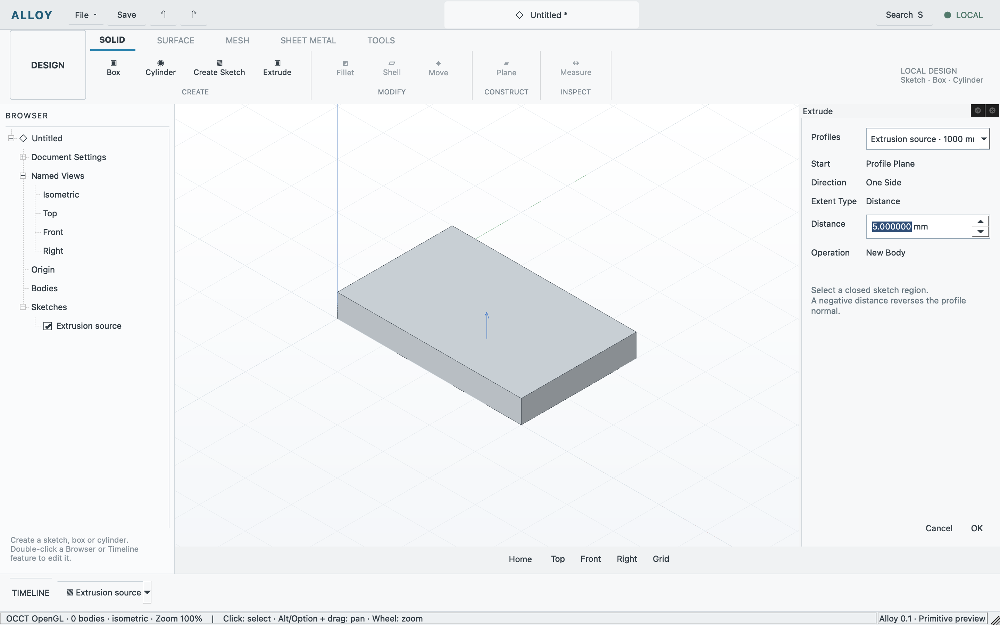

# Editable sketch-first extrusion checkpoint

Accepted on Apple silicon macOS with Qt 6.11.2, OCCT 7.9.3 and PlaneGCS.
[The receipt](sketch-extrusion.json) separates build, core, API, GPU, native and
independent visual evidence. This closes the bounded HIS-001, SOL-001 and
SKT-015 scopes; broader product and release gates remain open.

A finished, selected line-loop profile now extrudes into a real editable solid.
The right dock previews signed distance along the sketch's plane normal before
one commit. Preview and Cancel preserve the live authored document and journal.
Commit hides the consumed sketch in the same transaction. Browser visibility is
reversible; editing the source temporarily shows it and hides its dependent body.
Timeline editing preserves feature, body and profile identity.

The ordered evaluation pass resolves each extrusion against the current preceding
sketch/profile. A width change rebuilds both region and solid; missing, forward,
self or invalid profile references reject the complete candidate. Downstream
features cannot use retained geometry as a successful current result. Undo/redo
restore paired authored/evaluated snapshots; native files preserve authored
dependencies and rebuild geometry on reopen.



Presentation uses a neutral opaque preview, dark outlines and a blue plane-normal
cue. Fixed world lighting gives adjacent faces distinct tones. MSAA is selected
from actual driver capability; Apple M4 reports a maximum of four samples and
the configured view enables four. The backend remains OCCT OpenGL. The driver
version string's Metal wording does not establish a native Metal RHI.

The native build and five focused core tests passed. The final application binary
is `5ddb024941d36c7497d8f89b3a40ef0f0004f4b0b4ed06f2a11a3c804d171594`.
The shared runner passed primitive, constraint, annotation and extrusion cases
on that same binary, without duplicate runs for its checkpoint alias:

```sh
python3 tests/workflows/run.py --case sketch-extrusion-checkpoint --evidence build/evidence/extrusion-final
```

The real application fixture created a constrained 40 × 25 mm profile and a
5 mm solid of volume 5000 mm³. Changing width to 50 rebuilt the area to 1250 mm²
and volume to 6250 mm³. Undo/redo, reverse-distance preview/cancel, invalid
dependency preservation and save/reopen retained the chain and its IDs.

A separate native pass drew and dimensioned the rectangle, fixed its anchor,
finished the sketch, selected the profile and used E → 5 → OK. Timeline sketch
editing, label double-click → 50 → Enter → Finish, native undo/redo and cancelling
an 8 mm depth preview verified the same workflow without API modeling substitutes.
The native rectangle's anchor is offset by 0.12605042 mm; this is not evidence of
snapping. Two sequential native click calls opened the inline editor after the
tool's `clickCount:2` attempts only selected it. Save/reopen is covered by the
API case; native file dialogs were not repeated. The native fixture was saved
before opening [the 50 × 25 × 5 sample](../../examples/sketch-extrusion.alloy).

Astra independently checked the unchanged source and 37 recorded input hashes,
the matching binary, actual captures and native document states. The initial
blue wash-through and weak face distinction were corrected before acceptance.
Cancel restores the exact committed document, including its revision and journal.
Earlier failed captures are not accepted presentation evidence.

This slice supports one connected closed line loop, Distance, One Side and New
Body. Holes, curves, boolean modes, alternate extents, taper and expressions
remain follow-ups. The numeric UI uses fixed display units and signed values;
typed unit suffixes, a Flip button and an interactive manipulator are absent.
The opaque Home preview occludes its selected base; the blue cue is small and
noninteractive. Public reference scale, platform and theme are unmatched, so this
accepts the declared Alloy presentation without claiming exact visual parity.
Full tutorial exercises, STEP/export, platform packages, native Metal/Vulkan,
mounting-bracket and release gates remain unqualified. No CI run, tag or release
was created for this checkpoint.
