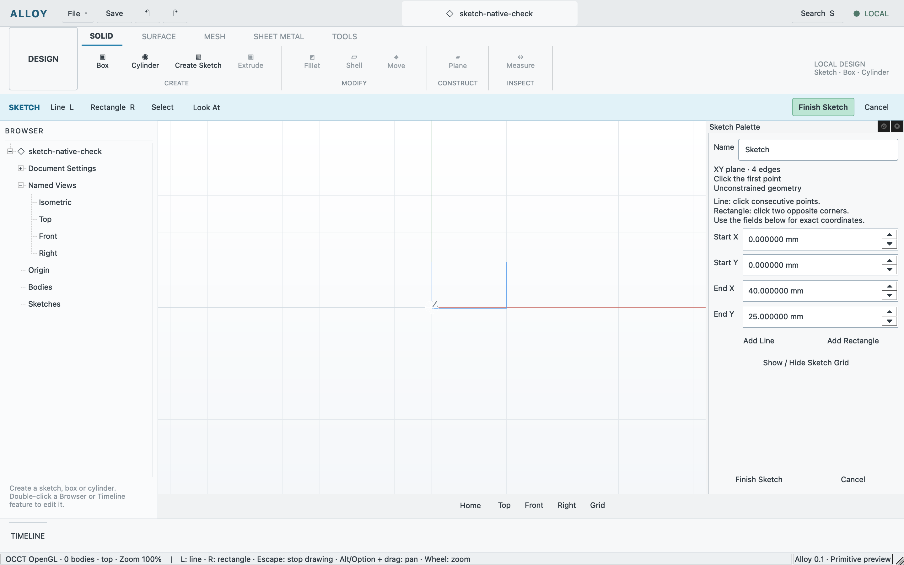

# Origin-plane sketches and line drawing

Recorded 2026-10-11 on macOS arm64. SKT-001/002 are implemented in the real Qt/OCCT
application: origin XY/XZ/YZ sketches, retained point/line UUIDs, connected lines,
two-point rectangles, contextual drawing tools and a docked Sketch Palette.
These are unconstrained authored edges; constraints and extrusion remain ahead.

[Candidate and evidence receipt](sketches.json) separates core tests, application
commands, native input and captures. Geometry kernel, document model and sketch
model CTest checks passed. The real sketch case passed creation cancellation,
all three plane frames, four-edge rectangles, connected endpoint identity,
edit/cancel, one journal entry per Finish, undo/redo and authored save/reopen.
The same GPU-accelerated candidate passed existing shell, document, shared-session
and primitive cases. The earlier combined report is retained as failed because
of a test expectation error; a corrected sketch-only run supplements its passed
existing cases. No unchanged application workflows were rerun for that correction.

Native computer-use checks chose XY, drew a rectangle with two viewport clicks,
stopped an unfinished line with L/Escape, finished one retained sketch, and
re-entered it from Timeline. Adding a line then closing the palette cancelled
without changing authored data. The new rectangle sample opened through the
actual application. The user's three-body document was preserved and reopened
in the current build. Astra independently checked source and matching evidence.



This is an Alloy capture with real OCCT GPU edges. It is not a matched reference
comparison. Finish commits one sketch edit through the existing QUndoStack;
Cancel discards the draft. Saved files retain authored coordinates/IDs, rebuild
geometry on reopen and start an empty session journal. Exact shared coordinates
reuse endpoints; snapping and constraint inference are not yet implemented.

## Reproduce when a material change warrants it

```sh
cmake --build build
ctest --test-dir build -R '^(geometry_kernel|document_model|sketch_document)$' --output-on-failure
python3 tests/workflows/run.py --case sketch-regression --evidence build/evidence/sketch-regression
```

For hands-on use, choose Create Sketch → XY/XZ/YZ, then Line (L) or Rectangle (R).
Click points, or use palette coordinates and Add Line/Add Rectangle. Finish Sketch
retains the feature. Timeline opens it again. Try Cancel, undo/redo and save/reopen.
`examples/rectangle-sketch.alloy` contains one independently authored 40×25 mm
rectangle. It has no driving dimensions, constraints or solid extrusion yet.

The separate [solver decision](../decisions/004-sketch-solver.md) selects PlaneGCS
behind a replaceable shared library after a passing native fixture. Application
solver integration belongs to SKT-003/004. Other-OS runtime/package qualification,
face-attached sketches, entity selection/dragging, closed profiles and extrusion
remain required work. No broad modeling gate or release acceptance is claimed.
