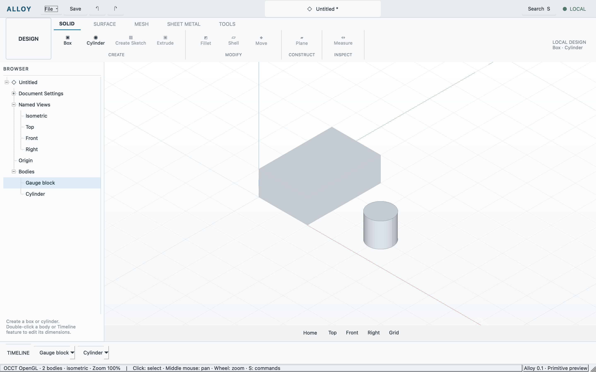

# Viewport mouse regression

Recorded 2026-10-11 local time on macOS 26.5.1 arm64, Qt 6.11.2,
OCCT 7.9.3 and Apple M4 OpenGL. [Machine receipt](viewport-input.json).

Mouse interaction exposed intermediate camera resets during redraw. OCCT
immediate updates are now disabled; synchronization publishes the completed
camera after orientation, centering, fit scale and pan. Resize retains the
drawable aspect, named views retain their direction, and fit uses the smaller
viewport dimension to keep tall geometry in view.

Picking, projection and pan convert Qt logical coordinates using native window
dimensions. Cocoa window dimensions are points; framebuffer dimensions remain
physical Retina pixels. Applying framebuffer DPR to input had displaced clicks
and doubled pan distances. Actual camera eye/center/direction/up/scale/aspect
are exposed in `app.state.viewport.gpu.camera`.

The fresh `primitive-regression` passed shell, authored document, shared sessions
and primitives once each on the final executable. Added assertions check aspect,
offset model centering, picking at two zoom levels without camera movement,
zoom scale, stable pan across inspections, and exact Top direction/centering.
Existing geometry, edits, undo/redo and save/reopen checks also passed.
The retained report is `build/evidence/viewport-fix-final/report.json`.

Computer-use tools separately clicked a visible cylinder, performed a left drag
and middle-button click, then scrolled up and down in the actual native viewport.
Inspection confirmed body selection, unchanged camera after clicks/drag,
zoom-only scale changes, restoration after downward scrolling, and unchanged
authored document. The user's three-body model was saved to a local recovery
copy before restart and reopened unchanged. The corrected app remains open.
Physical state evidence is under `build/evidence/viewport-fix-final/physical/`.

Astra independently reviewed the final source and retained evidence, confirmed
candidate consistency, and found no material blocker. Continuous middle-button
drag could not be exercised with the computer-use tool; its shared pan command
was checked through the real app. There is no temporal video or frame pacing
benchmark. Other-OS runtime, arbitrary orbit, face/edge selection and broader
interaction compatibility remain separate work; DOC-010 and GATE-010 stay open.

Implementation evidence uses permitted public OCCT source, retrieved 2026-10-11:
[V3d camera/projection/pan](https://github.com/Open-Cascade-SAS/OCCT/blob/V7_9_3/src/V3d/V3d_View.cxx),
[native Cocoa dimensions](https://github.com/Open-Cascade-SAS/OCCT/blob/V7_9_3/src/Cocoa/Cocoa_Window.mm),
[selector coordinates](https://github.com/Open-Cascade-SAS/OCCT/blob/V7_9_3/src/SelectMgr/SelectMgr_ViewerSelector.cxx).
